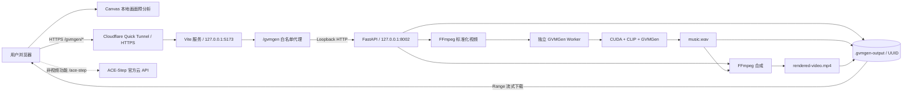
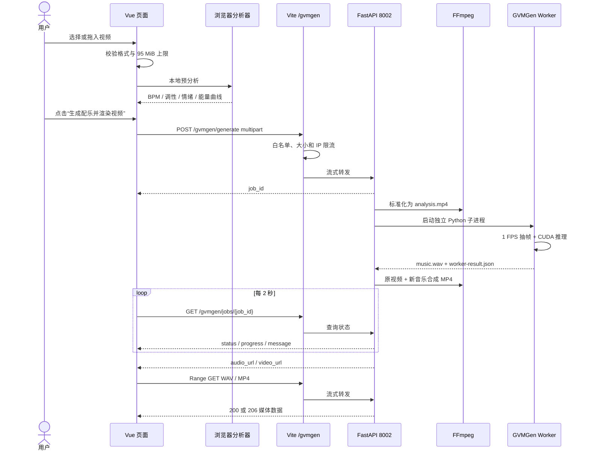

# MoodTrack 视频配乐技术文档

> 文档版本：1.0  
> 对应实现日期：2026-08-11  
> 适用目录：`moodtrack/frontend` 及 `moodtrack/services/GVMGen`

## 1. 文档目的

本文档描述 MoodTrack 当前“视频配乐”功能的完整技术实现，包括：

- 系统架构与信任边界；
- 浏览器端视频预分析算法；
- Vue 前端状态流与交互；
- `/gvmgen` 接口协议；
- Vite 同源代理与公网保护；
- FastAPI 作业服务；
- GVMGen/CUDA 推理流程；
- FFmpeg 预处理与音视频合成；
- 环境配置、启动、守护和监控；
- 测试、故障排查、安全风险与后续演进建议。

本文档面向开发、测试、部署和运维人员。它描述的是当前代码的真实行为，不把计划中的能力写成已经实现的能力。

## 2. 系统边界

MoodTrack 当前有两条彼此独立的音乐生成链路：

| 功能 | 生成引擎 | 请求前缀 | 是否使用本地 GPU | 是否把视频交给 ACE |
|---|---|---|---:|---:|
| 普通配乐、人声歌曲、情绪参考、局部重绘 | ACE-Step 官方云 API | `/ace-step` | 否 | 否 |
| 视频配乐 | 本地 GVMGen + FFmpeg | `/gvmgen` | 是 | 否 |

视频配乐不会调用 ACE 云 API，也不会把视频当作 ACE 的 Reference Audio。ACE 不直接读取或理解视频内容。

视频链路包含两套视觉理解：

1. 浏览器启发式预分析：产生 BPM、调性、情绪、能量曲线、配器和颜色等可解释结果，用于 UI 展示和主工作区映射。
2. GVMGen 模型推理：直接读取服务端标准化后的视频帧，以视觉条件生成音乐。

当前实现中，浏览器生成的 `productionPrompt`、`instrumentalStructure`、BPM、调性和情绪曲线没有传入 GVMGen。它们不是模型的实际条件参数。真实音乐由 GVMGen 根据视频帧独立生成。

## 3. 总体架构



公网只暴露指向 `127.0.0.1:5173` 的 Cloudflare Tunnel。Python 服务只绑定 `127.0.0.1:8002`，不应直接暴露到局域网或公网。

TLS 在 Cloudflare 边缘终止。本机的 Vite → FastAPI 调用使用 loopback HTTP。浏览器只访问同一个 MoodTrack 域名，因此不需要给 8002 配置 CORS。

## 4. 组件与代码职责

| 文件 | 主要职责 |
|---|---|
| [`frontend/src/App.vue`](../frontend/src/App.vue) | 视频弹窗、文件选择、拖放、预览、分析进度、生成状态、主播放器、WAV/MP4 下载 |
| [`frontend/src/video2music.ts`](../frontend/src/video2music.ts) | 浏览器 Canvas 抽帧和可解释视觉统计 |
| [`frontend/src/gvmgenClient.ts`](../frontend/src/gvmgenClient.ts) | 上传、任务轮询、网络重试与结果 URL 组装 |
| [`frontend/scripts/gvmgen-middleware.ts`](../frontend/scripts/gvmgen-middleware.ts) | `/gvmgen` 路由白名单、限流、大小限制和流式反向代理 |
| [`frontend/services/gvmgen_service.py`](../frontend/services/gvmgen_service.py) | FastAPI 服务、上传落盘、任务状态、FFmpeg、Worker 调度和媒体下载 |
| [`frontend/services/gvmgen_worker.py`](../frontend/services/gvmgen_worker.py) | 单次 CUDA 推理、波形归一化和 WAV 保存 |
| [`services/GVMGen/`](../services/GVMGen/) | 上游 GVMGen 模型源码、配置、视频采样和权重目录 |
| [`frontend/scripts/video-watchdog.ps1`](../frontend/scripts/video-watchdog.ps1) | 检查并恢复 8002 视频服务 |
| [`frontend/scripts/watchdog.ps1`](../frontend/scripts/watchdog.ps1) | 总守护：Vite、ACE 云、视频守护、视频服务和公网隧道 |
| [`frontend/vite.config.ts`](../frontend/vite.config.ts) | 注册 `/ace-step` 和 `/gvmgen` 中间件，监听 5173 |
| [`frontend/src/style.css`](../frontend/src/style.css) | 视频弹窗、指标、能量图、输出卡片和响应式布局 |

Python 服务对外统一使用 `MoodTrack` 品牌名；少量历史兼容变量仍保留原内部命名，但不会展示给用户。

## 5. 端到端请求时序



## 6. 浏览器端视频预分析

### 6.1 输入与采样

`analyzeVideoFile()` 使用隐藏的 `HTMLVideoElement` 与 Canvas 完成本地分析，文件在该阶段不会上传。

- 分析画布：`64 × 36`；
- 元数据或 seek 等待上限：15 秒；
- 预览音乐时长：

```text
musicDuration = clamp(round(video.duration), 15, 30)
```

- 抽样数量：

```text
sampleCount = clamp(round(video.duration / 4), 16, 28)
```

- 抽样点在整段原视频上等距分布；
- 最后一个安全时间点不超过 `duration - 0.04s`；
- 每个时间点通过 `video.currentTime` seek，随后把画面缩放至 64×36。

注意：对于超过 30 秒的视频，浏览器预分析覆盖整段视频，而服务端生成只处理开头最多 30 秒。这会造成预览统计与实际生成区段不完全一致，是当前已知技术债。

### 6.2 单帧统计

每个像素使用 BT.709 权重计算归一化亮度：

```text
Y = (0.2126 × R + 0.7152 × G + 0.0722 × B) / 255
```

饱和度：

```text
S = (max(R,G,B) - min(R,G,B)) / max(R,G,B)
```

当 `max(R,G,B) = 0` 时饱和度为 0。

暖度：

```text
warmth = clamp((avgR - avgB + 255) / 510, 0, 1)
```

运动量是当前采样帧与上一采样帧逐像素亮度绝对差的均值：

```text
motion = mean(abs(currentLuma - previousLuma))
```

单帧平均 RGB 同时用于生成十六进制色板。

### 6.3 切点、BPM 与能量

当某个采样帧的 `motion >= 0.22` 时，记为一个强事件边界。整体 `cutRate` 为强边界数量除以有效跨帧数量。

BPM 启发式：

```text
bpm = round(clamp(
  70 + motion × 260 + cutRate × 52 + saturation × 22,
  72,
  148
))
```

单帧能量：

```text
energy = round(clamp(
  18 + motion × 245
     + saturation × 31
     + abs(brightness - 0.46) × 18,
  16,
  98
))
```

### 6.4 调性映射

| 条件 | 调性 |
|---|---|
| `brightness > 0.58` 且 `warmth > 0.48` | `D major` |
| 否则 `brightness < 0.36` | `F minor` |
| 否则 `warmth > 0.55` | `A minor` |
| 其余 | `C minor` |

### 6.5 情绪节点

情绪曲线固定选取 0%、34%、68%、100% 四个位置。标签按以下顺序匹配：

1. 能量 ≥ 78：亮度 > 0.56 为“绽放”，否则为“爆发”；
2. `motion >= 0.16`：推进；
3. 亮度 < 0.32：沉潜；
4. 饱和度 > 0.42：明朗；
5. 能量 < 36：平静；
6. 其余：流动。

### 6.6 风格与配器

| 条件 | 风格 | 配器 |
|---|---|---|
| `motion > 0.16` 或 `cutRate > 0.2` | 电影感混合电子、动作节奏 | Hybrid Pulse、Spiccato Strings、Taiko、Sub Bass |
| 亮度 > 0.55 且饱和度 > 0.35 | 明亮现代电子 | Glass Pluck、Warm Synth、Electric Bass、Electronic Drums |
| 亮度 < 0.36 | 深色氛围电影配乐 | Dark Pad、Felt Piano、Cello、Low Pulse |
| 其余 | 现代叙事配乐 | Felt Piano、Ambient Guitar、Chamber Strings、Brush Kit |

色板取 12%、50%、88% 三个采样位置的平均色并去重。

### 6.7 预分析的真实作用

预分析结果会：

- 在弹窗显示 BPM、调性、运动量、切点、能量、情绪和色板；
- 写入 MoodTrack 主工作区的标题、场景、风格、描述、时长和情绪节点；
- 强制切换到纯音乐模式；
- 用于生成后的展示文案和播放器信息。

预分析结果当前不会：

- 作为 GVMGen 的显式 BPM 或调性控制；
- 作为文本 Prompt 传入 GVMGen；
- 控制 GVMGen 的具体乐器；
- 修改原视频音频；
- 调用 Text Emotion Agent 或 Emotion Reference Library。

## 7. Vue 前端状态与交互

### 7.1 主要状态

| 状态 | 含义 |
|---|---|
| `videoFile` | 当前原始视频文件 |
| `videoPreviewUrl` | 浏览器 Object URL 预览 |
| `videoAnalysis` | 本地可解释分析结果 |
| `analyzingVideo` | 是否正在浏览器分析 |
| `videoProgress` | 当前分析/生成进度 |
| `videoStatus` | 用户可见状态文本 |
| `videoError` | 当前错误文本 |
| `videoModeActive` | 主工作区是否处于视频配乐模式 |
| `video2MusicOpen` | 视频弹窗是否打开 |
| `gvmgenOnline` | `/gvmgen/health` 是否返回 `ready: true` |
| `gvmgenGenerating` | 是否正在生成视频配乐 |
| `gvmgenResult` | 完成后的 job、WAV 和 MP4 地址 |

### 7.2 文件选择

前端接受 MP4、WebM、MOV 和 M4V。校验包含：

- 浏览器 MIME 以 `video/` 开头，或文件扩展名命中白名单；
- 文件大小不超过 `95 × 1024 × 1024` 字节；
- 新文件会撤销旧 Object URL，清空旧分析、旧结果和进度。

当前前端没有最短视频时长校验。建议使用至少 5 秒的视频；少于 5 秒时，页面计划时长与实际可用帧数可能不一致。

### 7.3 生成与结果映射

点击生成后，`applyVideoPlan()` 会：

- 把标题改为“文件名 · 视频配乐”；
- 把场景改为“宽×高 视频配乐”；
- 写入分析风格、描述和四个情绪节点；
- 把时长设置为 15–30 秒的预览时长；
- 强制纯音乐；
- 清空普通音乐版本对比列表；
- 把主工作区标记为 `VIDEO2MUSIC`。

完成后：

- 主播放器切换到 `/gvmgen/files/{job}/music.wav`；
- 下载名为 `<源文件名>-soundtrack.wav`；
- 轨道编号为 `V2M-<job id 前 6 位>`；
- 编曲标签显示“层级视觉注意力”；
- 弹窗和主页面同时显示 WAV 与 MP4 下载；
- 页面滚动到视频输出区。

### 7.4 健康状态

组件挂载时并行检查 ACE 与 GVMGen。若任一尚未在线，前端每 5 秒重试；两者都在线后停止定时轮询。

这意味着两个引擎首次都在线后，如果 GVMGen 随后宕机，页面不会立即主动发现；它会在生成失败或页面刷新后更新状态。

## 8. 前端客户端与超时

[`gvmgenClient.ts`](../frontend/src/gvmgenClient.ts) 使用以下策略：

| 参数 | 当前值 |
|---|---:|
| API 前缀 | `/gvmgen` |
| 上传超时 | 5 分钟 |
| 初始轮询间隔 | 2 秒 |
| 单次状态请求超时 | 12 秒 |
| 总等待上限 | 20 分钟 |
| 连续瞬时失败容忍 | 8 次 |
| 最大退避间隔 | 8 秒 |
| 客户端时长约束 | 5–30 秒 |

短暂网络失败不会立即判定任务失败。每次失败后，轮询间隔按失败次数增加，最高 8 秒；成功请求会把失败计数清零。

## 9. `/gvmgen` API 协议

### 9.1 `GET /gvmgen/health`

经 Vite 转发至 `GET http://127.0.0.1:8002/health`。

示例：

```json
{
  "ready": true,
  "cuda": true,
  "model": "MoodTrack-Video2Music"
}
```

`ready: true` 只代表 CUDA 与两个权重文件通过基础检查，不代表模型、CLIP、FFmpeg 和完整推理一定可用。

### 9.2 `POST /gvmgen/generate`

请求类型：`multipart/form-data`

| 字段 | 类型 | 必填 | 说明 |
|---|---|---:|---|
| `video` | File | 是 | MP4、MOV、M4V 或 WebM |
| `duration` | Integer | 是 | 最终约束至 5–30 秒 |

成功：

```json
{
  "job_id": "9c170d51085a49a99ab5219048fda82b"
}
```

`job_id` 是 32 位十六进制 UUID。

### 9.3 `GET /gvmgen/jobs/{job_id}`

任务状态：

| 状态 | 典型进度 | 含义 |
|---|---:|---|
| `uploading` | 4 | 正在接收上传，通常在 POST 返回前出现 |
| `queued` | 10 | 文件已保存，准备执行 |
| `loading` | 18 | 准备模型或 Worker |
| `generating` | 34 | GVMGen 正在生成音乐 |
| `rendering` | 82 | FFmpeg 正在合成视频 |
| `completed` | 100 | WAV 和 MP4 已生成 |
| `failed` | 100 | 任务失败，`error` 提供摘要 |

完成示例：

```json
{
  "id": "9c170d51085a49a99ab5219048fda82b",
  "status": "completed",
  "progress": 100,
  "message": "MoodTrack 配乐与视频渲染完成",
  "duration": 15.0,
  "audio_url": "/files/9c170d51085a49a99ab5219048fda82b/music.wav",
  "video_url": "/files/9c170d51085a49a99ab5219048fda82b/rendered-video.mp4"
}
```

### 9.4 媒体接口

```text
GET /gvmgen/files/{job_id}/music.wav
GET /gvmgen/files/{job_id}/rendered-video.mp4
```

媒体响应支持单段 HTTP Byte Range：

- 无 Range：200；
- 合法单区间：206；
- 非法、越界或多区间：416；
- 响应包含 `Accept-Ranges: bytes`；
- 响应包含 `Cache-Control: no-store`；
- `Content-Disposition` 为 `inline`。

### 9.5 常见 HTTP 错误

| 状态码 | 产生位置 | 含义 |
|---:|---|---|
| 400 | FastAPI | 扩展名不在允许列表 |
| 404 | 代理/FastAPI | 路由、任务或输出文件不存在 |
| 413 | 代理/FastAPI | 上传超过限制 |
| 416 | FastAPI | Range 不合法 |
| 422 | FastAPI | multipart 字段缺失或结构错误 |
| 429 | 代理 | 同 IP 30 分钟超过 3 次 |
| 429 | FastAPI | 已有一个活动视频任务 |
| 502 | Vite 代理 | 无法连接 8002 或上游流失败 |
| 503 | FastAPI | CUDA 或权重未就绪 |

## 10. Vite 同源代理与保护

### 10.1 精确路由白名单

代理只允许：

```text
GET  /gvmgen/health
POST /gvmgen/generate
GET  /gvmgen/jobs/<32位十六进制UUID>
GET  /gvmgen/files/<32位十六进制UUID>/music.wav
GET  /gvmgen/files/<32位十六进制UUID>/rendered-video.mp4
```

其他路径或方法直接返回 404，不会触达 FastAPI。因此公网不能通过 5173 访问 FastAPI 的 `/docs` 或 `/openapi.json`。

### 10.2 上传限制

- UI 规范：95 MiB；
- FastAPI 实际文件内容：95 MiB；
- 代理声明的 `Content-Length`：100 MiB；
- 代理留出约 5 MiB 给 multipart 边界和字段开销。

如果请求没有 `Content-Length` 或使用 chunked 传输，代理层不能提前判断真实字节数，最终依靠 FastAPI 的流式 95 MiB 检查。

### 10.3 IP 限流

每个来源 IP 在滚动 30 分钟内最多提交 3 次 `POST /generate`。

IP 获取顺序：

1. `CF-Connecting-IP`；
2. `X-Forwarded-For` 第一个地址；
3. socket 远端地址；
4. `unknown`。

限流发生在请求转发前，因此无效格式、后端未就绪或后端并发拒绝也会消耗一次额度。第 4 次返回 429，并带 `Retry-After: 1800`。

限流数据只保存在 Vite 内存中：Vite 重启后清空；多实例之间不共享。它是防误用措施，不是用户级鉴权或计费系统。

### 10.4 请求头处理

代理不转发 `Host`、`Connection`、`Keep-Alive`、`Transfer-Encoding`、`Upgrade` 等 hop-by-hop 头，媒体请求和 multipart 请求均采用 Node HTTP 流转发。

待加固项：当前集合包含 `trailers`，标准头名通常为 `trailer`；同时没有解析 `Connection` 头中动态声明的额外 hop-by-hop 头。

## 11. FastAPI 作业服务

### 11.1 目录与环境变量

| 环境变量 | 默认值 | 用途 |
|---|---|---|
| `GVMGEN_ROOT` | `moodtrack/services/GVMGen` | 上游源码根目录 |
| `GVMGEN_CHECKPOINTS` | `%GVMGEN_ROOT%/checkpoints/small` | 权重目录 |
| `GVMGEN_OUTPUT` | `frontend/.gvmgen-output` | 上传、中间文件和结果 |
| `GVMGEN_FFMPEG` | 当前 Python 环境的 `Library/bin/ffmpeg.exe` | FFmpeg 路径 |

这些变量不会由 Vite 的 `.env.local` 自动加载。需要在启动 Uvicorn 的进程环境中设置，并且必须在导入 `services.gvmgen_service` 之前生效。

Worker 使用同一个 `sys.executable` 并继承服务进程环境。

### 11.2 模型就绪条件

`model_ready()` 同时要求：

- `torch.cuda.is_available()` 为真；
- `state_dict.bin` 存在且精确为 `987,396,005` 字节；
- `compression_state_dict.bin` 存在且精确为 `236,001,935` 字节。

默认目录：

```text
services/GVMGen/checkpoints/small/
├── state_dict.bin
└── compression_state_dict.bin
```

当前只校验大小，不校验 SHA-256、签名或权重来源。

### 11.3 上传与任务槽位

服务端只根据扩展名接受 `.mp4`、`.mov`、`.m4v`、`.webm`。原始文件名不直接用于落盘，服务端只提取扩展名并保存为：

```text
.gvmgen-output/<uuid>/source.<ext>
```

上传按 1 MiB 分块写入，累计超过 95 MiB 时返回 413。

`jobs_lock` 把“检查活动任务”和“登记新任务”放在同一临界区。只要存在非 `completed`/`failed` 任务，新请求就返回 429。

服务有 `ThreadPoolExecutor(max_workers=1)`，但当前行为不是排队等待，而是第二个任务直接被拒绝。

### 11.4 任务持久性

任务状态保存在 Python 进程内存中的 `jobs` 字典。服务重启后：

- `/jobs/{id}` 不再认识旧任务；
- 磁盘文件仍可能存在；
- 如果知道完整 UUID 和固定文件名，旧文件仍可能通过文件接口读取。

## 12. 视频预处理

服务先生成供模型使用的 `analysis.mp4`：

```text
ffmpeg -y
  -i source
  -t <requested_duration>
  -an
  -vf fps=30
  -c:v libx264
  -preset veryfast
  -crf 20
  -pix_fmt yuv420p
  -movflags +faststart
  analysis.mp4
```

作用：

- 取开头目标时长；
- 移除原始音频；
- 统一为 30 FPS；
- 统一为 H.264/yuv420p；
- 减少上游格式差异对抽帧和模型的影响。

当前 FFmpeg 子进程没有显式超时。异常媒体可能让唯一任务槽长期被占用。

## 13. GVMGen 推理

### 13.1 Worker 隔离

主服务为每个任务启动一个独立 Worker 子进程：

```text
python frontend/services/gvmgen_worker.py
  --video analysis.mp4
  --audio music.wav
  --metadata worker-result.json
  --duration <duration>
```

Worker 最长运行 19 分钟。独立进程能在任务结束后释放 GPU 资源，但也意味着每个任务都会重新加载模型和 CLIP，存在明显冷启动开销。8002 主进程本身不预热模型。

### 13.2 抽帧与生成

Worker 当前以 1 FPS 从标准化视频中抽帧，使用 CUDA 执行 GVMGen 生成。上游视频处理会把帧缩放并中心裁剪至 336×336，匹配 CLIP `ViT-L/14@336px`。

生成波形后：

```text
peak = max(abs(waveform))
waveform = waveform × (0.95 / peak)  # peak > 0 时
```

随后使用模型采样率保存 `music.wav`。

这是峰值归一化，不是 LUFS 响度标准化，也没有自动淡入、淡出或动态范围母带处理。

### 13.3 Checkpoint 兼容层

服务包含针对当前 small checkpoint 的兼容逻辑：

- CLIP：`ViT-L/14@336px`；
- Q-Former query 数：16；
- query 类型：mean；
- Q-Former 层数：6；
- cross-attention frequency：2；
- CUDA 下语言模型 dtype：float16；
- 把旧权重键 `query_token` 迁移为 `query_tokens`；
- 非允许范围的缺失权重或意外权重会抛出 checkpoint mismatch。

升级 PyTorch、Audiocraft、CLIP、OmegaConf、GVMGen 源码或 checkpoint 时，必须重新验证兼容层。

## 14. 音视频合成

合成阶段使用原始上传视频作为视频流，使用 `music.wav` 作为唯一音频流：

```text
-map 0:v:0
-map 1:a:0
```

因此，原视频音轨会被替换，而不是与配乐混合。

第一次尝试：

- 视频流直接复制：`-c:v copy`；
- 新音轨编码 AAC 192 kbps；
- `-shortest`；
- `+faststart`。

如果原视频编码不能直接封装到 MP4，则回退为：

- H.264 重编码；
- `veryfast`；
- CRF 20；
- `yuv420p`；
- AAC 192 kbps。

当前没有“保留环境声”“对白自动闪避”“混音比例”或“响度目标”等能力。

## 15. 输出文件生命周期

每个任务目录：

```text
frontend/.gvmgen-output/<job-id>/
├── source.mp4                 # 或原始扩展名
├── analysis.mp4               # 模型标准化输入
├── music.wav                  # 独立配乐
├── worker-result.json         # duration / sample_rate
└── rendered-video.mp4         # 带配乐成片
```

当前实现没有：

- 自动过期；
- 总容量上限；
- 定时清理；
- 删除接口；
- 用户所有权；
- 上传中断后的可靠残留清理。

失败任务也可能留下源文件或中间文件。长期运行必须监控磁盘占用，并制定保留周期。

清理时只应删除确认已过期、且没有正在执行任务的完整 UUID 目录。不要对 `.gvmgen-output` 根目录执行不受约束的递归删除。

## 16. 运行环境

### 16.1 推荐环境

- Windows 10/11；
- Node.js 18+ 与 pnpm；
- NVIDIA CUDA GPU；
- 独立 Conda/Python 环境；
- FFmpeg，包含 H.264、libx264 和 AAC；
- GVMGen small 权重；
- OpenAI CLIP `ViT-L/14@336px` 缓存或首次下载网络。

上游 GVMGen 推荐 Python 3.9。当前验证机使用 Python 3.10.18，并已完成真实生成。

### 16.2 当前验证机基线

| 组件 | 已验证版本/配置 |
|---|---|
| GPU | NVIDIA GeForce RTX 4090，24 GB |
| PyTorch | 2.0.0+cu118 |
| torchvision | 0.15.1+cu118 |
| torchaudio | 2.0.1+cu118 |
| CUDA runtime | 11.8 |
| FastAPI | 0.104.1 |
| MoviePy | 1.0.3 |
| OmegaConf | 2.3.0 |
| Audiocraft | 1.1.0 |
| OpenCV | 4.8.1.78 |
| FFmpeg | 7.1.1 |

CLIP 默认缓存位置：

```text
%USERPROFILE%\.cache\clip\ViT-L-14-336px.pt
```

离线机器必须预先准备该文件；否则首次生成可能尝试联网下载。

## 17. 安装与启动

### 17.1 Python 环境

```powershell
conda create -n gvmgen python=3.9
conda activate gvmgen
Set-Location "C:\Users\Drift king\Desktop\Moodtrack\moodtrack\services\GVMGen"
pip install -r requirements.txt
pip install python-multipart
```

需要根据显卡驱动安装兼容的 PyTorch/CUDA 版本。不要盲目升级核心依赖；当前服务带有 checkpoint 兼容补丁。

### 17.2 前台启动视频服务

在 `frontend` 目录执行：

```powershell
Set-Location "C:\Users\Drift king\Desktop\Moodtrack\moodtrack\frontend"
& "E:\anaconda3\envs\gvmgen\python.exe" `
  -m uvicorn services.gvmgen_service:app `
  --host 127.0.0.1 `
  --port 8002
```

前台启动适合首次安装和故障排查。

### 17.3 启动页面

```powershell
Set-Location "C:\Users\Drift king\Desktop\Moodtrack\moodtrack\frontend"
pnpm install
pnpm dev --host 127.0.0.1
```

Vite 监听 `127.0.0.1:5173`，并注册 `/gvmgen` 代理。

### 17.4 守护启动

推荐运行总守护：

```powershell
powershell.exe -NoProfile -ExecutionPolicy Bypass `
  -File "C:\Users\Drift king\Desktop\Moodtrack\moodtrack\frontend\scripts\watchdog.ps1"
```

视频守护也可以单独运行：

```powershell
powershell.exe -NoProfile -ExecutionPolicy Bypass `
  -File "C:\Users\Drift king\Desktop\Moodtrack\moodtrack\frontend\scripts\video-watchdog.ps1" `
  -PythonPath "E:\anaconda3\envs\gvmgen\python.exe"
```

## 18. 守护与恢复策略

总守护每 20 秒检查：

- `http://127.0.0.1:5173/`；
- `/ace-step/health`；
- 视频 watchdog 进程；
- `http://127.0.0.1:8002/health`；
- 指向 5173 的 Cloudflare Tunnel。

如果视频 watchdog 不存在，总守护在隐藏窗口启动它。

视频 watchdog 每 20 秒检查 8002。只有同时满足以下条件时才启动 Uvicorn：

- health 失败；
- 没有匹配的 Uvicorn 进程；
- 配置的 Python 路径存在。

如果 Uvicorn 进程仍存在但已经卡死、持续返回 `ready: false` 或内部不可用，当前 watchdog 不会杀掉或替换它，需要人工确认。

## 19. 日志与监控

| 文件 | 内容 |
|---|---|
| `frontend/.watchdog.log` | 总守护状态变化 |
| `frontend/.watchdog.out.log` | 总守护标准输出 |
| `frontend/.watchdog.err.log` | 总守护错误 |
| `frontend/.video-watchdog.out.log` | 视频守护输出 |
| `frontend/.video-watchdog.err.log` | 视频守护错误 |
| `frontend/.gvmgen-service.log` | Uvicorn/服务标准输出 |
| `frontend/.gvmgen-service.err.log` | 服务、Worker 或依赖错误 |
| `frontend/.vite-demo.log` | Vite 输出与热更新 |
| `frontend/.vite-demo.err.log` | Vite/页面错误 |
| `frontend/.tunnel.err.log` | Cloudflare Tunnel 日志与公网 URL |
| `frontend/.tunnel-url.txt` | 当前公网 URL |

健康检查：

```powershell
Invoke-RestMethod http://127.0.0.1:8002/health
Invoke-RestMethod http://127.0.0.1:5173/gvmgen/health
```

公网检查：

```powershell
$publicUrl = (Get-Content -LiteralPath '.tunnel-url.txt' -Raw).Trim()
Invoke-RestMethod "$publicUrl/gvmgen/health"
```

监控必须解析 `ready`，不能只检查 HTTP 200，因为 `ready: false` 仍然可能返回 200。

当前 health 不验证：

- 模型能否真正加载；
- CLIP 缓存是否完整；
- 剩余显存；
- FFmpeg 是否可执行；
- 磁盘剩余空间；
- 实际生成是否能够完成。

正式运行应增加低频、短时长的端到端 canary，而不是只依赖 health。

## 20. 公网安全模型

### 20.1 当前能力级别

当前系统具有基础的公开演示保护：

- 8002 只绑定 loopback；
- Vite 路由白名单；
- 文件与任务 UUID 不可枚举；
- UI/代理/服务三层大小限制；
- 每 IP 生成频率限制；
- 全局单任务；
- 下载路径与固定文件名校验；
- FFmpeg 和 Worker 使用参数数组，不经过 shell；
- 媒体响应 `no-store`。

但当前 Quick Tunnel 没有 Cloudflare Access、登录态、API Token、账户配额或用户所有权校验。知道公网 URL 的人就能调用生成接口。IP 限流不能替代鉴权。

### 20.2 主要威胁

1. 公网 GPU 滥用：匿名用户可消耗 GPU、带宽与磁盘。
2. 分块或慢速上传：缺少代理层真实字节计数和明确上传超时。
3. 不可信媒体：只按扩展名判断，没有 magic、ffprobe 结构与解码资源上限。
4. FFmpeg 卡死：normalize/render 没有服务端超时，可能长期占用唯一任务槽。
5. 磁盘增长：输出无 TTL、配额或清理任务。
6. 隐私：拿到 UUID 即可下载文件，URL 不签名、不失效。
7. 错误泄露：Worker 错误尾部可能包含本机路径或依赖细节。
8. 假健康：CUDA 与权重大小正常不等于完整推理正常。
9. 开发服务器暴露：Vite dev server 和 Quick Tunnel 不是正式生产边界。
10. 供应链：权重仅按大小检查，第三方解码器和深度学习依赖版本较旧。

### 20.3 路径与命令注入保护

- 原始文件名不直接用于路径，只保留白名单扩展名；
- job 目录由 `uuid.uuid4().hex` 生成；
- 下载文件名只允许 `music.wav` 和 `rendered-video.mp4`；
- 下载路径 `resolve()` 后再次验证父目录；
- FFmpeg 使用参数数组，未启用 `shell=True`。

这些措施降低路径穿越和命令注入风险，但不能防止恶意媒体触发解码器漏洞或资源耗尽。

## 21. 部署一致性风险

仓库中存在 `frontend` 与旧 `heartbeat` 两套历史视频服务副本。如果旧服务先占用 8002，MoodTrack 的新 `/gvmgen` 代理仍会连接它，造成“源码规范”和“实际运行行为”不一致。

已观察到的典型漂移是：

- `frontend` 服务端规范为 95 MiB；
- 旧 `heartbeat` 服务曾允许 750 MiB；
- 输出可能写到不同 `.gvmgen-output` 目录；
- 代理使用新白名单，但实际 8002 后端可能仍是旧进程。

部署验收必须确认：

- 只有一个 `gvmgen_service` 实例；
- 它的工作目录是 `moodtrack/frontend`；
- 输出目录是预期的 `frontend/.gvmgen-output`；
- 实际上传上限为 95 MiB；
- 8002 没有被旧 `heartbeat` watchdog 抢占；
- 运行文件版本与当前仓库一致。

在有真实任务运行时不要贸然终止 8002。应先确认没有活动任务，再做进程和工作目录切换。

## 22. 构建与测试

### 22.1 静态检查

```powershell
Set-Location "C:\Users\Drift king\Desktop\Moodtrack\moodtrack\frontend"
pnpm run build
python -m py_compile .\services\gvmgen_service.py .\services\gvmgen_worker.py
[void][ScriptBlock]::Create((Get-Content .\scripts\video-watchdog.ps1 -Raw))
[void][ScriptBlock]::Create((Get-Content .\scripts\watchdog.ps1 -Raw))
```

### 22.2 健康测试

```powershell
$direct = Invoke-RestMethod http://127.0.0.1:8002/health
$proxy = Invoke-RestMethod http://127.0.0.1:5173/gvmgen/health

if (-not $direct.ready -or -not $proxy.ready) {
  throw '视频服务未就绪'
}
```

### 22.3 真实生成测试

```powershell
$videoPath = 'C:\path\to\sample.mp4'
$created = curl.exe -sS -X POST `
  -F "video=@$videoPath;type=video/mp4" `
  -F "duration=5" `
  'http://127.0.0.1:5173/gvmgen/generate' | ConvertFrom-Json

$jobId = $created.job_id
do {
  Start-Sleep -Seconds 2
  $job = Invoke-RestMethod "http://127.0.0.1:5173/gvmgen/jobs/$jobId"
  "$($job.status) $($job.progress)% $($job.message)"
} while ($job.status -notin @('completed', 'failed'))

if ($job.status -eq 'failed') {
  throw $job.error
}
```

验证媒体 Range：

```powershell
curl.exe --range 0-255 -o NUL -w "audio=%{http_code} bytes=%{size_download}`n" `
  "http://127.0.0.1:5173/gvmgen/files/$jobId/music.wav"

curl.exe --range 0-255 -o NUL -w "video=%{http_code} bytes=%{size_download}`n" `
  "http://127.0.0.1:5173/gvmgen/files/$jobId/rendered-video.mp4"
```

期望均返回 206，且下载字节数为 256。

### 22.4 已验证基线

2026-08-11 已用仓库内 21.35 秒、约 2.5 MB 的 MP4 完成 5 秒真实链路测试：

- 通过 `127.0.0.1:5173/gvmgen` 上传；
- 状态从 `generating` 进入 `completed`；
- 生成 WAV；
- 生成带配乐 MP4；
- 两个文件的 Range 请求均返回 206；
- 公网首页、`/ace-step/health`、`/gvmgen/health` 均返回 200。

健康通过不能替代真实生成测试；该基线证明当时的完整链路确实运行过。

## 23. 安全与鲁棒性测试清单

### 23.1 路由

- 每条白名单路由做正向测试；
- 对 PUT、PATCH、DELETE、OPTIONS、错误 UUID、非 hex、超长 UUID 做 404 断言；
- 验证 `/gvmgen/docs`、`/gvmgen/openapi.json` 无法从公网代理访问；
- 验证 8002 只监听 127.0.0.1。

### 23.2 上传边界

- 95 MiB - 1、95 MiB、95 MiB + 1；
- 100 MiB 前后；
- Content-Length、chunked、缺失长度、慢速上传、上传中断；
- 空文件、损坏文件、假扩展、MIME 不符；
- 超高分辨率、异常 FPS、异常码率、多视频流、多音轨。

### 23.3 限流与并发

- 同 IP 第 1–3 次允许，第 4 次 429；
- 30 分钟窗口过期后恢复；
- 无效格式是否计数；
- Vite 重启后计数是否清空；
- 两个并发任务只能有一个进入；
- Worker、FFmpeg、CUDA OOM、磁盘满时必须进入 `failed` 终态。

### 23.4 下载

- 200 全量；
- 206 固定范围、开放末尾、suffix；
- 416 越界、负数、多 Range；
- 核对 Content-Range、Content-Length、Accept-Ranges 和 no-store；
- 并发 Range 下载与带宽限制。

### 23.5 恢复与隐私

- 重启 Vite、FastAPI、Tunnel 后的状态；
- 服务重启后旧 job 状态丢失；
- 磁盘残留文件是否仍可通过 UUID 下载；
- 日志不得记录上传内容、环境变量、密钥或敏感令牌；
- Worker traceback 对外响应必须脱敏。

## 24. 故障排查

| 现象 | 可能原因 | 检查与处理 |
|---|---|---|
| 页面显示“视频模型准备中” | 8002 未启动或 `ready: false` | 依次检查 8002 和 5173 `/gvmgen/health` |
| `/generate` 返回 503 | CUDA/权重未就绪 | 检查 PyTorch CUDA、两个权重文件及启动环境 |
| `/gvmgen/*` 返回 502 | Vite 不能连接 8002 | 检查 Uvicorn、video watchdog 和 `.gvmgen-service.err.log` |
| 返回 413 | 文件超过有效 95 MiB | 压缩或裁剪视频 |
| 返回 429 | IP 限流或已有活动任务 | 查看响应 `detail`，等待窗口或当前任务结束 |
| 第一次生成很慢 | Worker 每次冷加载模型/CLIP | 确认 CLIP 已缓存、GPU 空闲，考虑后续常驻模型 |
| checkpoint mismatch | 依赖、源码或权重版本不匹配 | 恢复验证版本，不要直接绕过 strict 检查 |
| FFmpeg 失败 | 编码不支持、文件损坏、路径或磁盘问题 | 优先 H.264 MP4，检查 FFmpeg、libx264、AAC 和磁盘 |
| 任务停在 generating | Worker 卡住、GPU OOM、服务状态丢失 | 查询 job、GPU、Worker、错误日志；注意 19/20 分钟上限 |
| 任务停在 rendering | FFmpeg 卡住 | 当前无 FFmpeg timeout，需要人工确认进程 |
| 输出 404 | job ID 错误、文件未完成或已清理 | 检查任务终态和对应 UUID 目录 |
| health 为 true 但生成失败 | 健康检查过浅 | 检查 CLIP、FFmpeg、依赖、显存、磁盘并跑真实 canary |
| 输出写入 heartbeat | 旧服务抢占 8002 | 验证唯一服务实例和工作目录，空闲时切换 |

## 25. 已知限制

1. 只处理视频开头最多 30 秒。
2. 浏览器分析长视频整段，但模型只看前 30 秒。
3. 浏览器预分析参数没有传给 GVMGen。
4. 原视频音频被替换，不支持保留环境声或对白闪避。
5. 全站一次只能生成一个视频。
6. Worker 每个任务重新加载模型，冷启动成本高。
7. 没有取消任务接口。
8. 任务状态只在内存中。
9. 输出没有 TTL、配额和自动清理。
10. 健康检查不覆盖真实推理与 FFmpeg。
11. FFmpeg normalize/render 没有服务端超时。
12. 只按扩展名检查视频，不验证 magic 或 ffprobe 安全策略。
13. 没有账户、用户隔离和正式鉴权。
14. Quick Tunnel 地址和可用性没有正式 SLA。
15. 静态 Sites 构建不能运行 Vite 中间件、FastAPI、CUDA 或 FFmpeg。

## 26. 推荐演进路线

### P0：正式公网前必须完成

- 使用 Cloudflare Access、应用登录或服务端签名令牌保护生成接口；
- 在代理和服务端按真实流字节计数，不依赖 Content-Length；
- 为上传、FFmpeg 预处理和 FFmpeg 合成增加超时与子进程清理；
- 增加输出 TTL、磁盘配额、失败残留清理；
- 统一 8002 唯一实例，移除 heartbeat 运行时漂移；
- 对外错误脱敏，内部 traceback 只写受控日志。

### P1：可靠性与产品一致性

- 用 ffprobe 或沙箱预检真实媒体、codec、时长、分辨率、FPS 和流数量；
- 增加任务取消、服务重启恢复和持久化 job 元数据；
- 将模型常驻 GPU 或设计可控的预热/卸载策略；
- 让浏览器分析只覆盖实际生成区段；
- 明确选择：把分析参数真正接入模型条件，或把它定位为纯解释层；
- 增加原声保留、配乐音量、对白闪避和 LUFS 标准化；
- 增加定期小样本端到端 canary。

### P2：扩展能力

- 长视频按镜头/段落切分生成并做跨段主题一致性；
- 多任务队列、账户配额和可观测性；
- R2/对象存储承载输出，D1/数据库保存任务元数据；
- 签名下载 URL、用户所有权和自动过期；
- 正式生产反向代理，补充 CSP、HSTS、X-Content-Type-Options、Referrer-Policy 等安全头。

## 27. 许可证与第三方依赖

仓库内 GVMGen 源码包含 Apache-2.0 许可证。GVMGen 依赖 CLIP、MusicGen/Audiocraft、Encodec、FFmpeg、PyTorch 等第三方组件，源码许可证不自动等同于模型权重、基础模型和生成内容的商业使用许可。

在公开发布、商业化或提供多用户服务前，应分别核对：

- GVMGen 源码许可证；
- GVMGen checkpoint 的发布条款；
- MusicGen/Audiocraft/Encodec 的模型与代码许可；
- CLIP 模型许可；
- FFmpeg 构建所包含 codec 的许可；
- 用户上传视频和原始音频的权利；
- 生成音乐与合成视频的使用政策。

## 28. 部署验收清单

- [ ] Vite 只监听 `127.0.0.1:5173`。
- [ ] FastAPI 只监听 `127.0.0.1:8002`。
- [ ] 只有一个 GVMGen 服务实例。
- [ ] 服务工作目录为 `moodtrack/frontend`。
- [ ] 两个 checkpoint 文件存在且通过验证。
- [ ] CLIP 缓存可用。
- [ ] FFmpeg、libx264、AAC 可用。
- [ ] `/gvmgen/health` 返回 `ready: true`。
- [ ] 95 MiB 实际上传上限生效。
- [ ] 代理路由白名单生效。
- [ ] 同 IP 30 分钟 3 次限流生效。
- [ ] 第二个并发任务返回 429。
- [ ] 真实 5–30 秒样本生成完成。
- [ ] WAV 和 MP4 Range 下载返回 206。
- [ ] 输出目录、日志和模型权重均不进入 Git。
- [ ] 已配置输出保留和清理策略。
- [ ] 正式公网已配置鉴权，而不只是匿名 Quick Tunnel。

## 29. 上游参考

- [GVMGen 论文](https://arxiv.org/abs/2501.09972)
- [GVMGen 项目主页](https://chouliuzuo.github.io/GVMGen/)
- [仓库内 GVMGen README](../services/GVMGen/README.md)
- [MoodTrack 总 README](../README.md)
